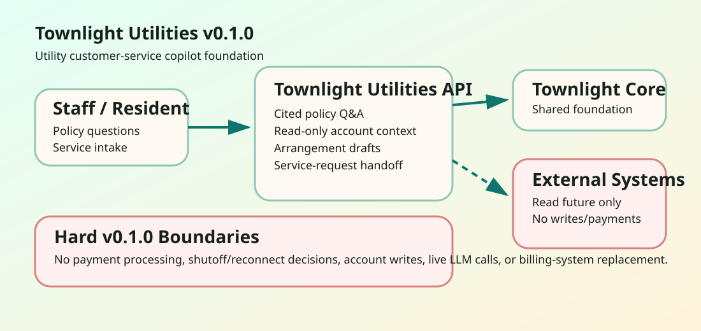

<a id="civicutility-user-manual"></a>

# Townlight Utilities User Manual

## Non-Technical Staff

Townlight Utilities helps utility customer-service representatives prepare clear, cited answers about billing policies, service rules, payment options, conservation guidance, and service-request intake. It can summarize read-only account context in a CSR-safe way, draft payment-arrangement language for staff review, prepare service-request handoffs, and optionally save account/service workpapers for later review.

Staff remain responsible for every resident-facing answer. Townlight Utilities does not approve payment arrangements, process payments, modify accounts, issue shutoff or reconnect decisions, dispatch crews, or replace the utility billing system.

## IT / Technical

Install with:

```bash
python -m pip install -e ".[dev]"
python -m uvicorn civicutility.main:app --host 127.0.0.1 --port 8142
```

Runtime dependency: `civiccore==0.3.0`.

Primary endpoints:

- `GET /health` - service and Townlight Core version.
- `GET /civicutility` - public sample UI.
- `POST /api/v1/civicutility/policy-answer` - cited policy answer draft.
- `POST /api/v1/civicutility/account-context` - read-only CSR-safe account context.
- `GET /api/v1/civicutility/account-context/{snapshot_id}` - persisted account context retrieval when configured.
- `POST /api/v1/civicutility/payment-arrangement-draft` - staff-review arrangement draft.
- `POST /api/v1/civicutility/service-request-intake` - Townlight 311 handoff-ready intake draft.
- `GET /api/v1/civicutility/service-request-intake/{intake_id}` - persisted service-request intake retrieval when configured.

Optional persistence is controlled by `CIVICUTILITY_WORKPAPER_DB_URL`. Use it only for CSR-safe account snapshots and service-request intake drafts. Townlight Utilities still does not write to billing systems, process payments, approve arrangements, dispatch crews, or write back to Townlight 311.

## Architecture



Townlight Utilities is a module on top of Townlight Core. v0.1.1 is deterministic and local with optional workpaper persistence: no live billing connector, live LLM call, account write, payment processing, or Townlight 311 write-back is shipped.
